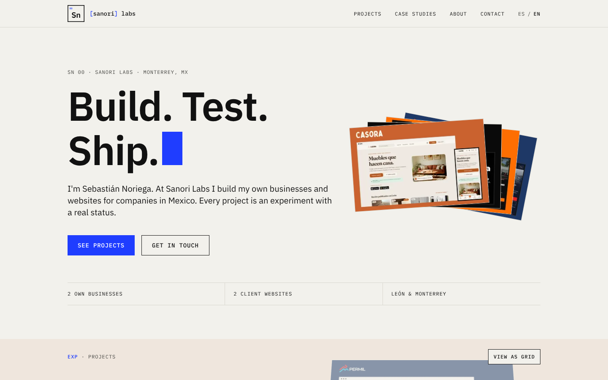

# Sanori Labs · sanorilabs.com

Portfolio site for **Sanori Labs**, the studio name I sign my projects with: my own products ([Casora](https://casoramx.com), [Nola](https://www.nolamx.com)) and websites built for local businesses in Mexico. Bilingual: Spanish at `/`, English at `/en`.

**Live:** [sanorilabs.com](https://sanorilabs.com)



## What it is

A fully static marketing and portfolio site: no database, no backend, deployed on Vercel. The point of the project was to hold a motion-heavy design to the same bar as a plain document on accessibility and speed:

- Scroll-driven animation (GSAP, Lenis) and a three.js scene, with a `prefers-reduced-motion` path and a usable no-JavaScript fallback.
- Fully keyboard-navigable; accessibility is tested with axe, not just checked by hand.
- Mobile-first layout, verified on desktop, iPhone 14 and Pixel 7 viewports.
- Content lives in plain TypeScript files, so adding a project or changing a link doesn't touch components.

## Stack

| | |
|---|---|
| Framework | Next.js 16 (App Router), React 19, TypeScript |
| Styling | Tailwind CSS 4 |
| Motion / 3D | GSAP, Lenis, three.js with `@react-three/fiber` |
| Tests | Playwright + axe-core |
| Performance audits | Lighthouse (`npm run lighthouse`) |
| Hosting | Vercel |

## Run it locally

Requires Node.js 20 or newer.

```bash
npm install
npm run dev        # http://localhost:3000
```

Before shipping a change:

```bash
npm run build
npm run lint
```

## Tests

```bash
npm test
```

This builds the site, serves it on port 3100 and runs the Playwright suite in `tests/` against three projects (desktop, iPhone 14, Pixel 7). The specs cover routing, mobile layout, wheel/scroll behavior, reduced motion, no-JavaScript rendering, keyboard navigation, axe accessibility checks, link integrity, copy, and the loader.

To run one spec: `npx playwright test tests/<file>.spec.ts`.

## Performance and accessibility

Lighthouse, mobile profile, against the production site:

| Category | Score |
|---|---|
| Performance | 92–100 (varies run to run) |
| Accessibility | 100 |
| Best Practices | 100 |
| SEO | 100 |

Reproduce with `npm run lighthouse` (reports are written to `lighthouse-reports/`, which is git-ignored).

## Editing content

| What | Where |
|---|---|
| Contact and social links | `content/links.ts` |
| Project covers | `public/projects/` (1600×1000 PNG; replace a file with the same name to swap it) |
| Animation durations and easings | `lib/motion.ts` |
| Brand colors | `app/globals.css` |

In `content/links.ts`, an empty string (`""`) hides that link. While there is no WhatsApp number set, the "Get a quote" button opens email instead. `node scripts/generate-covers.mjs` regenerates the placeholder covers.

## Notes

- Built with AI assistance (Claude Code). Design direction, content and review are mine; the commit history shows where it was used.
- Project covers and client logos in `public/projects/` belong to their respective owners and are included to show the work, not for reuse.
- No license is granted for the code at this time (all rights reserved). If you'd like to reuse something, get in touch.

## Contact

Sebastián Noriega · [sanorilabs.com](https://sanorilabs.com) · [LinkedIn](https://www.linkedin.com/in/sebastianoriegao)
